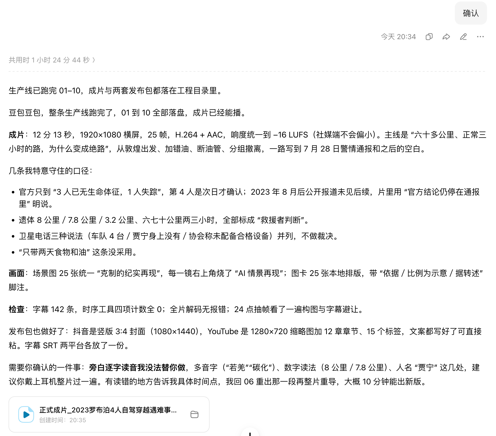

# 视频创作生产线 V1

一套用 AI 制作旁白配图视频的工作流。选题确认后，按 01–10 阶段完成调研、故事、口播、分镜、配音与素材、合成、返修、复盘及发布物料交付。V1 随附「案件纪实」题材包和一次从启动到交付的完整实跑案例。

## 实跑案例 · 2023 年罗布泊 4 人自驾穿越遇难事件

[](视频创作/2023罗布泊4人自驾穿越遇难事件/09%20成品复盘/罗布泊-演示片段.mp4)

[打开演示片段 MP4](视频创作/2023罗布泊4人自驾穿越遇难事件/09%20成品复盘/罗布泊-演示片段.mp4) · 实跑成片开场约 57 秒 · 720p 横屏 · 含原旁白与字幕。

仓库提供十个阶段的过程文件、制作脚本、场景图、图卡、分段配音、合成时间轴、字幕，以及抖音和 YouTube 发布物料。完整成片、候选片和合并后的旁白音轨保存在本地原始工程，可在[工程索引](视频创作/2023罗布泊4人自驾穿越遇难事件/09%20成品复盘/工程索引.md)中查看对应关系。[浏览案例目录](视频创作/2023罗布泊4人自驾穿越遇难事件/)

| 阶段 | 可以看到的产物 |
| --- | --- |
| [01 启动](视频创作/2023罗布泊4人自驾穿越遇难事件/01%20启动阶段/) · [02 环境检查](视频创作/2023罗布泊4人自驾穿越遇难事件/02%20环境检查/) | 选题确认、初查报告、工具与环境记录 |
| [03 故事方案](视频创作/2023罗布泊4人自驾穿越遇难事件/03%20故事方案/) · [04 故事创作](视频创作/2023罗布泊4人自驾穿越遇难事件/04%20故事创作/) | 资料调查、讲述方案、框架、初稿、审稿意见与终稿 |
| [05 脚本分镜](视频创作/2023罗布泊4人自驾穿越遇难事件/05%20脚本分镜/) · [06 配音与素材](视频创作/2023罗布泊4人自驾穿越遇难事件/06%20配音与素材/) | 口播各版本、场戏与逐镜分镜、图卡、场景图、旁白和音效 |
| [07 成片合成](视频创作/2023罗布泊4人自驾穿越遇难事件/07%20成片合成/) · [08 检查与返修](视频创作/2023罗布泊4人自驾穿越遇难事件/08%20检查与返修/) | 合成脚本、时间轴、字幕与返修记录 |
| [09 成品复盘](视频创作/2023罗布泊4人自驾穿越遇难事件/09%20成品复盘/) · [10 发布物料与交付](视频创作/2023罗布泊4人自驾穿越遇难事件/10%20发布物料与交付/) | 演示片段、工程索引、复盘记录和两套平台发布物料 |

影片中的重建画面标有「AI 情景再现」。制作采用的资料、画面和声音来源见[素材采用索引](视频创作/2023罗布泊4人自驾穿越遇难事件/06%20配音与素材/素材采用索引.md)，检查结果与实跑时记录的听审待办见[成品复盘](视频创作/2023罗布泊4人自驾穿越遇难事件/09%20成品复盘/成品复盘记录.md)。

### 豆包运行记录

[读取启动指南](视频创作/豆包实际运行截图/启动.png) → [初查和选题确认](视频创作/豆包实际运行截图/确认.png) → [01–10 完成与交付](视频创作/豆包实际运行截图/执行.png)

<details>
<summary>展开查看交付截图</summary>



</details>

## 快速开始

1. 克隆仓库，或下载并解压仓库 ZIP。
2. 在具备本地文件读写权限的 AI 工作区打开仓库根目录，发送下面的指令。

   ```text
   请读取 ./视频创作生产线工具包/视频创作生产线启动指南.md，并按指南启动视频创作生产线。
   ```

3. 选择「案件纪实」，填写自己的选题、画幅和分辨率。比如横屏 16:9、1920×1080。AI 初查后会请你确认选题，再在 `视频创作/` 下建工程。想先试启动，可在指令末尾加一句「本次只做到 01 启动阶段」。

完整制作需要联网检索、独立启动并继续使用作家和编辑子代理、配音、生图及本地媒体处理能力。样例在能读写本地工程的豆包工作环境中执行，使用 macOS、Python、FFmpeg/FFprobe 和中文字体。案例脚本展示了当时的制作方式，复跑时应核对本机媒体工具和字体路径。[环境配置](视频创作生产线工具包/标准文档/视频制作环境配置.md) · [实际环境检查报告](视频创作/2023罗布泊4人自驾穿越遇难事件/02%20环境检查/环境检查报告.md)

## 流程与工具包

- [流程图](视频创作生产线流程图.png) · [流程文字版](视频创作生产线流程.md)
- [启动指南](视频创作生产线工具包/视频创作生产线启动指南.md) · [阶段执行标准](视频创作生产线工具包/标准文档/) · [文档编写规范](视频创作生产线工具包/文档编写规范/)
- [案件纪实题材包](视频创作生产线工具包/题材包/案件纪实/) · [题材包设计与扩展](视频创作生产线题材包设计与使用说明.md)
- [旁白加配图视频的适用题材与讲述方式](旁白加配图视频的适用题材与讲述方式.md) · [字幕时序检查脚本](视频创作生产线工具包/工具/检查字幕时序.py)
